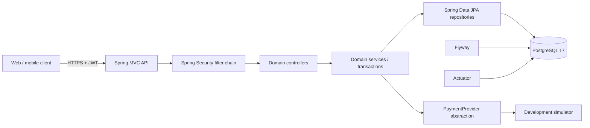
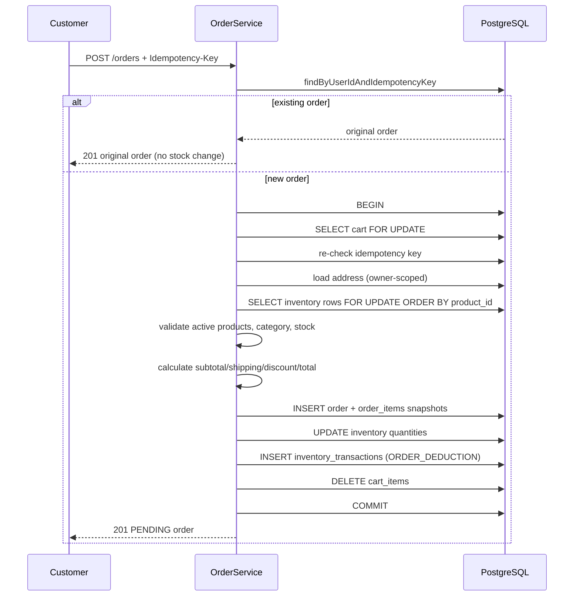
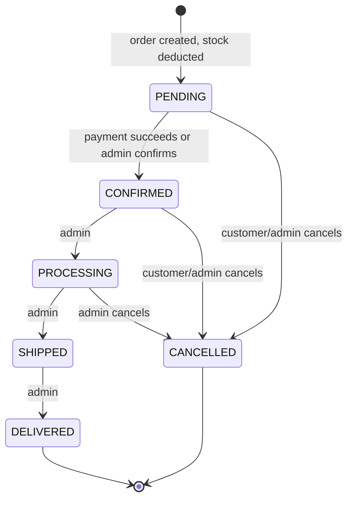

# NexaCart Architecture

Related documents: [Project structure](PROJECT_STRUCTURE.md) for package ownership and extension points, [Development guide](DEVELOPMENT.md) for conventions and tests, and [Configuration and operations](OPERATIONS.md) for runtime settings.

## 1. Architectural style

NexaCart is a **modular monolith**. Each business domain owns its HTTP contract, DTOs, service logic, entities, and repositories. Domains collaborate through explicit service/repository calls inside one process and one PostgreSQL database. There are no microservices, message brokers, or distributed transactions.

This keeps local operation simple while preserving clear boundaries and making a future extraction of modules possible if justified.



### Module boundaries

| Module | Owns | Collaborates with |
|---|---|---|
| `auth` | Registration, login, JWT issuing, logout/revocation, token cleanup | `user`, `security` |
| `security` | JWT decoding/validation, security error handlers, rate limiter | `auth`, `user` |
| `user` | Accounts, roles, profile, admin account management | none |
| `category` | Category lifecycle and public/admin category views | `product` visibility checks |
| `product` | Catalog, SKU/slug rules, search/filter/sort/page | `category`, `inventory` |
| `inventory` | Stock balances, adjustments, low-stock, ledger | `product`, `user` |
| `cart` | Per-customer cart, server-side totals, checkout readiness | `product`, `inventory`, pricing |
| `address` | Address CRUD and single-default invariant | `user`, consumed by orders |
| `order` | Cart checkout, snapshots, status machine, cancellation | cart, address, inventory, payment records |
| `payment` | Provider abstraction, payment lifecycle, idempotent completion | order |
| `review` | Verified-purchase reviews and rating aggregation | product, order items, user |
| `common` | Base entity, pricing, errors, page/error envelopes, slug utility | all |
| `config` | Properties, security wiring, OpenAPI, dev seeding | all |

Controllers do not contain business rules. Services define transaction boundaries. Repositories only access data. JPA entities are never serialized; separate request/response records define the API contract.

The physical layout follows this model directly: each domain package owns `controller`, `dto`, `entity`, `repository`, and `service` subpackages, while `common`, `config`, and `security` hold cross-cutting code. See [Project structure](PROJECT_STRUCTURE.md) for the directory map and the rules for adding code.

## 2. Request lifecycle

1. Spring Security's rate-limit filter handles login/register only.
2. The OAuth2 resource-server filter validates JWT signature, `exp`, and issuer.
3. `JwtTokenValidator` checks:
   - the `jti` is present and not in `revoked_tokens`;
   - the subject user exists and is enabled.
4. `JwtAuthenticationConverter` loads the user's **current** role from PostgreSQL and assigns `ROLE_ADMIN` or `ROLE_CUSTOMER`. A role change therefore applies without waiting for token expiry.
5. URL rules and `@PreAuthorize` enforce coarse-grained access.
6. Services enforce ownership and business rules.
7. `GlobalExceptionHandler` converts domain errors and validation failures into a stable JSON `ApiError`.
8. Successful responses use DTO records; pages use `PageResponse`.

## 3. Persistence and schema management

- PostgreSQL is the only supported runtime database.
- Flyway owns all schema changes. Hibernate runs with `ddl-auto: validate`.
- Primary keys are UUIDs generated by Hibernate.
- All timestamps are `Instant` in UTC, stored as `TIMESTAMPTZ`.
- Money is `NUMERIC(12,2)` and `BigDecimal` with scale 2 / `HALF_UP`.
- Unidirectional relationships are preferred, except `Order -> OrderItem`, where cascade + orphan removal are useful.
- Lazy loading is the default. Product reads use entity graphs, and Hibernate batch fetch size (50) limits N+1 queries elsewhere.
- The schema enforces critical invariants:
  - unique lower-case email, category name, and product SKU;
  - unique cart per user and unique product per cart;
  - unique cart-items `(cart_id, product_id)`;
  - unique order `(user_id, idempotency_key)`;
  - unique payment provider reference;
  - one pending payment per order (partial unique index);
  - one default address per user (partial unique index);
  - unique review `(product_id, user_id)`;
  - checks for non-negative stock/prices/totals and ratings 1–5;
  - foreign keys with deliberate `RESTRICT`/`CASCADE`/`SET NULL` behavior.
- Access-pattern indexes include:
  - products by category, status, price, creation time;
  - trigram GIN indexes on lower(name), lower(description) for catalog search;
  - orders by `(user_id, created_at DESC)`, status, and created time;
  - inventory transactions by product, reference, and time;
  - reviews by product/user;
  - payments by order and status.

### Entity-relationship diagram

```mermaid
erDiagram
    USERS ||--o{ ADDRESSES : owns
    USERS ||--o| CARTS : owns
    USERS ||--o{ ORDERS : places
    USERS ||--o{ REVIEWS : writes
    USERS ||--o{ REVOKED_TOKENS : revokes

    CATEGORIES ||--o{ PRODUCTS : contains
    PRODUCTS ||--|| INVENTORY : has
    PRODUCTS ||--o{ INVENTORY_TRANSACTIONS : audits
    PRODUCTS ||--o{ CART_ITEMS : referenced_by
    PRODUCTS ||--o{ ORDER_ITEMS : snapshot_of
    PRODUCTS ||--o{ REVIEWS : receives

    CARTS ||--o{ CART_ITEMS : contains
    ORDERS ||--o{ ORDER_ITEMS : contains
    ORDERS ||--o{ PAYMENTS : paid_by

    USERS {
        uuid id PK
        varchar email UK
        varchar password_hash
        varchar first_name
        varchar last_name
        varchar role
        boolean enabled
        bigint version
        timestamptz created_at
        timestamptz updated_at
    }
    ADDRESSES {
        uuid id PK
        uuid user_id FK
        varchar recipient_name
        varchar line1
        varchar city
        varchar country
        boolean is_default
        bigint version
    }
    CATEGORIES {
        uuid id PK
        varchar name UK
        varchar slug UK
        boolean active
    }
    PRODUCTS {
        uuid id PK
        uuid category_id FK
        varchar name
        varchar slug UK
        varchar sku UK
        numeric price
        varchar status
        bigint version
    }
    INVENTORY {
        uuid id PK
        uuid product_id FK_UK
        integer quantity
        integer low_stock_threshold
        bigint version
    }
    INVENTORY_TRANSACTIONS {
        uuid id PK
        uuid product_id FK
        varchar transaction_type
        integer delta
        integer previous_quantity
        integer new_quantity
        varchar reason
        uuid reference_id
        uuid performed_by_id FK
    }
    CARTS {
        uuid id PK
        uuid user_id FK_UK
    }
    CART_ITEMS {
        uuid id PK
        uuid cart_id FK
        uuid product_id FK
        integer quantity
    }
    ORDERS {
        uuid id PK
        uuid user_id FK
        varchar status
        numeric subtotal
        numeric shipping_cost
        numeric discount_amount
        numeric total_amount
        varchar currency
        varchar idempotency_key
        varchar recipient_name
        varchar shipping_line1
        varchar shipping_city
        varchar shipping_country
        timestamptz cancelled_at
        bigint version
    }
    ORDER_ITEMS {
        uuid id PK
        uuid order_id FK
        uuid product_id FK
        varchar product_name
        varchar sku
        numeric unit_price
        integer quantity
        numeric line_total
    }
    PAYMENTS {
        uuid id PK
        uuid order_id FK
        varchar provider
        varchar provider_reference UK
        varchar status
        numeric amount
        varchar currency
        varchar failure_reason
        varchar refund_reference
        timestamptz paid_at
        timestamptz refunded_at
        bigint version
    }
    REVIEWS {
        uuid id PK
        uuid product_id FK
        uuid user_id FK
        integer rating
        varchar title
        varchar comment
        boolean verified_purchase
        bigint version
    }
    REVOKED_TOKENS {
        uuid id PK
        varchar jti UK
        uuid user_id FK
        timestamptz expires_at
    }
```

The order stores shipping fields as a snapshot rather than pointing at the current address. `order_items` stores product name, SKU, and unit price as immutable snapshots; `product_id` is nullable only for referential resilience if a product were ever hard-deleted (the API only deactivates products).

## 4. Transactions and consistency

### Order creation

Order creation is the most concurrency-sensitive workflow.



Key properties:

- Cart row lock serializes checkout against cart changes.
- Inventory locks are acquired in ascending product-ID order, so concurrent orders cannot deadlock on two products.
- All validation occurs before any stock mutation.
- Order, item snapshots, stock deduction, ledger records, and cart clearing are in one transaction.
- If any step fails, all changes roll back.
- A unique `(user_id, idempotency_key)` database constraint is the final defense against concurrent duplicate orders.
- If a concurrent insert hits the unique constraint, the service reads the committed original order and returns it. The rolled-back attempt has already released its transaction, so it cannot double-deduct stock.
- Loading the cart for checkout intentionally does **not** fetch inventory entities before the lock query. This avoids Hibernate's "conflicting version in persistence context" when another transaction commits a stock change between the cart read and the lock.

### Cancellation

Cancellation locks the order first, then lock-sorts inventory rows before restoring quantities. Payment rows are updated while the order row is locked. The state change to `CANCELLED` happens after refund/restock work, all in one transaction. Repeated cancellation returns the existing cancelled order without restoring stock again. Shipped/delivered orders reject cancellation.

### Inventory locking choice

A pessimistic `SELECT ... FOR UPDATE` strategy was chosen over optimistic retries or a raw atomic decrement because checkout needs consistent reads of multiple inventory rows plus exact pre/post quantities for the audit ledger. The database constraint `quantity >= 0` remains a second line of defense.

An atomic `UPDATE inventory SET quantity = quantity - :n WHERE quantity >= :n` would be faster but would require separate follow-up reads/ledger logic and complicates multi-item atomic validation and error reporting. The project's scale assumptions favor clarity and correctness.

### Money

- Unit prices are snapshotted.
- `lineTotal = unitPrice * quantity`, scale 2, `HALF_UP`.
- Subtotal is the sum of line totals.
- Shipping is free when subtotal >= configured threshold, otherwise the flat configured fee. Empty carts have no shipping.
- Discount is currently always `0.00` because there is no promotion rule; the field exists for totals consistency.
- Total = subtotal + shipping − discount, normalized to scale 2 and never below zero.

## 5. Order lifecycle



- Customer cancellation: only `PENDING` and `CONFIRMED`.
- Admin cancellation: also `PROCESSING`.
- No cancellation after `SHIPPED`.
- Invalid or skipped transitions return HTTP 409.
- Stock is deducted at order creation, so a `PENDING` order holds its stock. There is currently no unpaid-order expiry job.

## 6. Payments

Payments are separated from order orchestration through `PaymentProvider`:

```java
String name();
Initiation initiate(Order order);
RefundResult refund(Payment payment);
```

The only implementation is `SimulatedPaymentProvider`, which creates `sim_...` references and immediate simulated refunds. It never accepts or stores card data.

Idempotency measures:

1. `payments.provider_reference` is unique.
2. A partial unique index allows at most one `PENDING` payment per order.
3. Payment initiation locks the order row, so concurrent initiation returns one pending payment.
4. Completion loads the payment, locks the order, then locks the payment; this is the same lock order used by cancellation.
5. A repeated successful completion of an already `SUCCEEDED` payment returns the same row.
6. Terminal state mismatches return 409.
7. Cancellation marks pending payments `FAILED`; late completion cannot succeed.
8. Successful payments are refunded (`REFUNDED`) if a cancellation is permitted.

For a real provider, add signature-verified webhooks, provider event IDs with a unique event table, asynchronous reconciliation, and outbox-backed side effects. The simulation endpoint must remain development-only. The `prod`/`production` profile blocks it regardless of configuration.

## 7. Security architecture

- **Password storage:** BCrypt cost 12.
- **Token format:** HMAC-SHA256 JWT with issuer, subject, `jti`, issue/expiry, email, and roles claims.
- **Validation:** Spring Security's Nimbus decoder plus issuer/expiry validators, revocation lookup, and current account-state lookup.
- **Authority source:** current database role, not the token's role claim.
- **Logout:** inserts the current `jti` into `revoked_tokens` using PostgreSQL `ON CONFLICT DO NOTHING`, making logout idempotent. A scheduled job removes expired rows.
- **Statelessness:** no HTTP session or auth cookie; CSRF disabled as a consequence. This must be revisited if cookie authentication is introduced.
- **CORS:** explicit origins from configuration; no wildcard.
- **Rate limiting:** fixed-window in-memory limiter for login/register keyed by remote address and path. Suitable for a single instance only.
- **Ownership:** service-level checks; cross-customer reads return 404.
- **Mass assignment:** request records only contain permitted fields. Public registration never accepts a role.
- **Error handling:** stable codes and messages; no stack traces or SQL details for 500s.
- **Actuator:** health and info exposed; health details hidden; only health is public.
- **Secrets:** environment-only JWT secret; DB credentials externalized; `.env` ignored by Git.

## 8. Testing architecture

- **Unit tests:** pricing, state machine, rate-limit filter.
- **Integration tests:** one Spring context + one shared PostgreSQL Testcontainers instance, with tables truncated before each test.
- **Real PostgreSQL:** Flyway, constraints, partial unique indexes, row locking, and JSON serialization are all exercised against the actual target database.
- **Concurrency tests:** direct service calls in two threads trigger real database locks:
  - concurrent same-idempotency-key requests produce one order;
  - two customers competing for the last unit produce one winner and one conflict.
- **Failure-path tests:** unauthorized/forbidden, ownership violations, disabled accounts, invalid transitions, negative stock, missing headers, empty carts, duplicate payments.
- **No mocks for the database layer** in integration tests. This is intentional: the highest-risk behavior is transactional and database-specific.
- **Test placement:** unit tests live in the package of the class under test; integration tests live in their domain package and extend `IntegrationTestBase`. See [DEVELOPMENT.md](DEVELOPMENT.md#7-testing-guide).

## 9. Important trade-offs

| Decision | Benefit | Cost |
|---|---|---|
| Modular monolith | Simple deployment, strong transactions | Requires discipline to keep boundaries |
| Pessimistic inventory locks | Correct multi-item reservation and audit values | Lower throughput on hot SKUs |
| Deduct stock at order creation | No overselling while awaiting payment | Abandoned pending orders hold stock |
| JWT denylist + DB role/state checks | Real logout and immediate role/disable enforcement | Database work on every authenticated request |
| Database-backed idempotency | Survives restarts and concurrent retries | Unique-conflict handling path |
| Simulated payment provider | Safe local end-to-end flow | Not a production payment solution |
| Testcontainers only | Tests real PostgreSQL behavior | Docker required for tests |
| Trigram-indexed `LIKE` search | No extra infrastructure | Not as capable as a search engine |
| In-memory rate limit | No Redis dependency | Per-instance only |
| Global shipping/discount rules | Understandable core | No per-region promotions yet |
